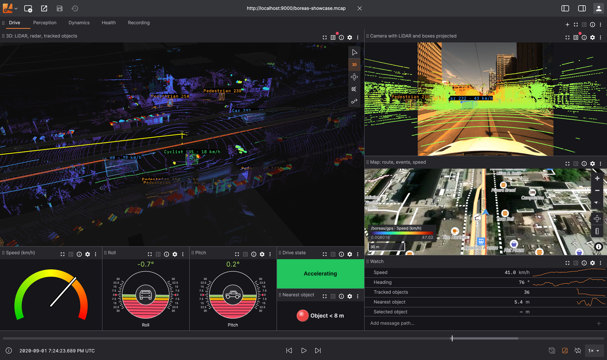
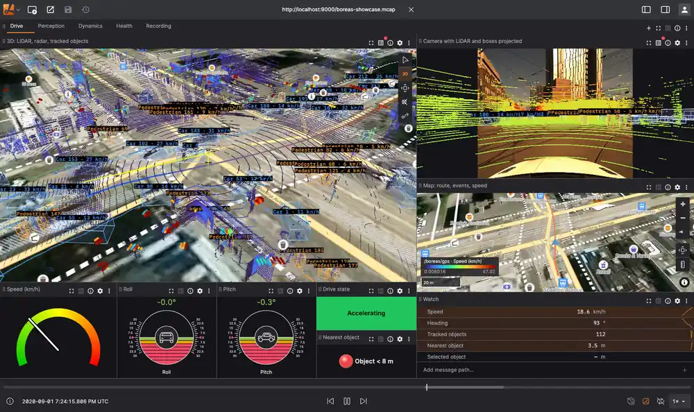

<h1 align="center">Lichtblick</h1>

<p align="center">
Visualization and diagnosis for robotics, in your browser or as a desktop app on Linux, Windows, and macOS.
</p>

<p align="center">
  
</p>

## :rocket: Try it

**[Open Lichtblick in your browser](https://licht.marko.im/)**: no install. **[Open the sample](https://licht.marko.im/?ds=sample-boreas)** for a camera, LiDAR, radar, GPS and IMU recording with a layout that shows off the panels, or choose **Explore sample data** on the start screen for more robotics recordings.

## :sparkles: Highlights

<p align="center">
  
</p>

- **Recordings**: MCAP (with ROS 1/2, Protobuf, CDR, JSON, CBOR, MessagePack, Cap'n Proto), ROS bags, ULog, CSV/TSV. Broken or still-growing MCAP files open while their index is rebuilt.
- **Live data**: Foxglove WebSocket and Rosbridge, with a rolling history you can pause, seek and replay, and every live session recorded to MCAP in the browser.
- **Compare recordings** side by side, shift them in time, and plot them on one chart.
- **Panels**: 3D, Image and Camera Grid, Map (MapLibre, 3D buildings), Plot (FFT, histogram, thresholds), Watch, Raw Messages, Log, Topic Health, Transform Tree, Teleop, Audio, Gauge, Notes, and more.
- **Layouts**: tabs, drag topics and fields onto any panel, undo/redo, starter templates that pick topics by schema.
- **Command palette** (<kbd>Cmd/Ctrl</kbd>+<kbd>K</kbd>) for panels, topics, message paths and actions.
- **Extensions**: runs Foxglove-built extensions.

## :hammer_and_wrench: Development

Requires [Node.js](https://nodejs.org/) 26+ and [pnpm](https://pnpm.io/) (`npm install --global pnpm` switches to the version pinned in `package.json`).

```sh
git clone https://github.com/mrkbac/lichtblick.git
cd lichtblick
pnpm install
```

```sh
pnpm web:serve        # web app on http://localhost:8080

pnpm desktop:serve    # desktop: dev server, then in a second terminal
pnpm desktop:start    # launch Electron
```

On Ubuntu, if the desktop app has GPU issues, run it with `LIBGL_ALWAYS_SOFTWARE=1 pnpm desktop:start`.

### Production builds

```sh
pnpm web:build:prod                 # output in web/.webpack
pnpm desktop:build:prod             # then one of:
pnpm package:linux                  # .deb and .tar.gz in dist/
pnpm package:darwin
pnpm package:win
pnpm clean                          # remove build output
```

The Linux `.tar.gz` does not install system libraries. Installing Chrome usually brings them; otherwise launch from a terminal and install whatever library it names (typically `libgtk-3-0 libnss3 libasound2 libgbm1 libxtst6`).

## :satellite: Telemetry

Off unless the build sets `OTLP_ENDPOINT`; there is no runtime toggle. When enabled, only a fixed set of named UI events (see [`AppEvent`](packages/suite-base/src/services/IAnalytics.ts)) with anonymous random IDs is sent as OTLP/HTTP logs and traces to `${OTLP_ENDPOINT}/v1/logs` and `/v1/traces`, rate-limited per session. No message data, file contents or personal data.

## :pencil: License

[Mozilla Public License v2.0](/LICENSE). See [CONTRIBUTING.md](CONTRIBUTING.md) to contribute.

## :star: Credits

This is a fork of **[Lichtblick](https://github.com/lichtblick-suite/lichtblick)** by BMW AG and the Lichtblick contributors, licensed under MPL 2.0. Most of this code comes from upstream Lichtblick; thank you to everyone who built and maintains it. Lichtblick itself began as a fork of [Foxglove Studio](https://github.com/foxglove/studio) by [Foxglove](https://foxglove.dev/).

The sample recordings are adapted from public datasets; see [sample credits and conversion details](packages/suite-base/src/dataSources/samples/README.md). The Boreas sample recording and the screenshot's recording are adapted from the [Boreas dataset](https://www.boreas.utias.utoronto.ca/) (CC BY 4.0, Keenan Burnett et al., University of Toronto).
